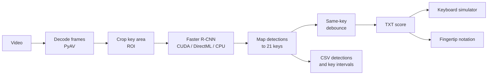

<div align="center">


# Key Press Detection

Turn Genshin Impact Windsong Lyre performance videos into playable scores.


English | [简体中文](README.zh-CN.md)

</div>

Key Press Detection reads the on-screen keys and saves a timestamped TXT score. You can play the score with the keyboard simulator or convert it to Fingertip notation.

## Demo

<div align="center">

[](docs/media/windsong-lyre-demo.mp4)

[Video with audio](docs/media/windsong-lyre-demo.mp4) · [Still image](docs/media/windsong-lyre-preview.png) · [Generated TXT score](docs/media/windsong-lyre_keys.txt)

</div>


## Features

- Detects all 21 lyre keys frame by frame and writes a timestamped TXT score, with the raw detections saved as CSV.
- Lets you preview the video, move the key boxes, click keys to disable them, and reset the boxes to their default positions.
- Plays a saved score into the game from a separate simulator window, with hotkeys to pause and stop.
- Converts a score to Fingertip notation with BPM, time signature, first-bar offset and bars per line settings.
- Runs inference with CUDA on NVIDIA or DirectML on NVIDIA, AMD and Intel, and falls back to CPU.
- Ships as a portable package with Python, dependencies and models, so there is nothing else to install.

## How it works



Each frame is cropped to the key area before it reaches the detector. The detected boxes are matched to the 21 key regions, and repeated hits on the same key within the debounce window are merged before the TXT score is written.

## Download and run

Choose a Windows x64 portable package from Releases:

| Edition | GPU inference | Dependencies |
| --- | --- | --- |
| CUDA | CUDA on NVIDIA; DirectML on AMD and Intel | Includes PyTorch and the CUDA runtime |
| DirectML | DirectML on NVIDIA, AMD and Intel | Uses ONNX Runtime; smaller download |

> [!NOTE]
> Both editions have CPU fallback. DirectML defaults to FP32, with mixed FP16 available in Settings. CUDA has a separate AMP switch.

1. Extract the whole portable package and run `start.cmd`.
2. Select a video and output folder, then load the preview.
3. Check the key regions. Move boxes or click keys to disable them, then start inference.

> [!TIP]
> For the split CUDA download, put `.part001`, `.part002`, `.parts.json` and `join-release.cmd` in the same folder. Double-click `join-release.cmd` to merge and verify the ZIP, then extract it.

### System requirements

| Item | Requirement |
| --- | --- |
| OS | Windows 10/11 x64 |
| GPU | NVIDIA (CUDA or DirectML), AMD or Intel (DirectML); CPU also works |
| Driver | The graphics driver for your GPU |
| Other software | None. The portable package includes Python, dependencies and models |

## Models

Model downloads sit beside the portable packages in Releases. To update or replace a model, download its model asset:

| Asset | Use |
| --- | --- |
| `KeyPressDetection-Model-FasterRCNN-ONNX.zip` | DirectML and CPU; includes FP32 and mixed FP16 graphs for batch 1 and 16 |
| `KeyPressDetection-Model-FasterRCNN-PyTorch.zip` | CUDA inference in the CUDA edition |

Extract the ZIP into the application folder and merge its `models` folder. In Settings, select `models/faster_rcnn.onnx` for DirectML or `models/faster_rcnn.pth` for CUDA.

> [!IMPORTANT]
> Keep the ONNX files and `weights.data` together. For the CUDA edition's DirectML and CPU fallback, download both matching model assets.

## Output

Completed results use the video's name and appear in the output folder. Each job gets its own folder:

| File | Contents |
| --- | --- |
| `<video>_keys.txt` | Timestamped score after debounce, used by the simulator and conversion |
| `<video>_detections.csv` | Raw per-frame detections of enabled keys, with confidence |
| `<video>_key_events.csv` | Press intervals per key (start, end, duration), inferred from samples |
| `<video>_summary.json` | Run metrics such as backend, precision, frame counts and timing |
| `preview.jpg` | Latest preview frame with key highlights |
| `task.log` | Short English job log |
| `job.json` | Job metadata |

Stopping a job discards its unfinished results. Score manager deletes an entire job folder at a time.

### Score format

Each line has a timestamp in seconds, a tab, and the keys pressed at that moment:

```text
0.90	Q,C
1.00	Q
1.33	Q,D
1.73	Q,A
```

Key names follow the in-game keyboard layout:

<div align="center">

<kbd>Q</kbd> <kbd>W</kbd> <kbd>E</kbd> <kbd>R</kbd> <kbd>T</kbd> <kbd>Y</kbd> <kbd>U</kbd><br>
<kbd>A</kbd> <kbd>S</kbd> <kbd>D</kbd> <kbd>F</kbd> <kbd>G</kbd> <kbd>H</kbd> <kbd>J</kbd><br>
<kbd>Z</kbd> <kbd>X</kbd> <kbd>C</kbd> <kbd>V</kbd> <kbd>B</kbd> <kbd>N</kbd> <kbd>M</kbd>

</div>

Blank lines and `#` comments are ignored. The simulator accepts UTF-8, UTF-16 with BOM and GB18030 files of up to 8 MiB, 200,000 rows and 24 hours.

## Simulator

The simulator reads saved TXT scores or uploaded files. It runs in a separate administrator window and stays open after the web service closes.

| Shortcut | Action |
| --- | --- |
| <kbd>F6</kbd> | Start, pause or resume |
| <kbd>F8</kbd> | Stop and reset |

You can change both shortcuts in Settings. Switching windows pauses playback.

## Score conversion

Score conversion produces Fingertip notation. You can set the BPM, time signature, first-bar offset and bars per line.

| Notation | Meaning |
| --- | --- |
| `G` | Single note |
| `(DZ)` | Chord, with the keys pressed together |
| `/` | End of a bar |
| Space | Rest, also used for layout |

You can edit the preview and download it as `<original>_formatted.txt`. The simulator plays timestamped TXT scores, not Fingertip notation.

## Settings

Same-key debounce defaults to 50 ms. Video previews keep their original aspect ratio. Key regions can be reset to their default positions, and CPU thread count is adjustable in Settings.

## FAQ

<details>
<summary>I closed the browser. Did inference stop?</summary>

No. Inference keeps running while the CMD window is open. Closing CMD ends the web service and inference, and unfinished results are lost. To get back to the page, open the address shown in CMD, normally `http://127.0.0.1:8765`. If that port is taken, the app tries the next ports.

</details>

<details>
<summary>Why is the first run slow?</summary>

The first run at a given input size prepares the model and compiles it for the GPU. Later runs use the cached graph.

</details>

<details>
<summary>The key boxes don't line up with my video.</summary>

Key regions scale with the video size, but a different on-screen layout needs calibration. Drag the boxes with **Move key regions**, or enter coordinates in the advanced parameters. **Reset positions** restores the default layout. Save the layout to reuse it in the next job.

</details>

<details>
<summary>Some notes are missing from the score.</summary>

Lower resolution and frame skipping (frame stride) can both miss short notes. Try the default input size with a stride of 1, or lower the confidence threshold slightly from its default of 0.8. Larger batches or more CPU threads do not always improve throughput.

</details>

<details>
<summary>What if the same note is detected more than once?</summary>

Try increasing **Same-key debounce** under Advanced to reduce duplicate detections of the same key. Setting it too high can also filter out genuine rapid repeats, causing missed notes.

</details>

<details>
<summary>The simulator stopped in the middle of a song.</summary>

Switching windows or holding a modifier key pauses playback and releases all keys. Return to the game and press the start/pause shortcut (<kbd>F6</kbd> by default) to resume. Returning focus alone does not resume playback.

</details>

<details>
<summary>Can I test the simulator without sending keys?</summary>

Yes. Run this from the application folder:

```bat
runtime\python.exe simulator.py --dry-run
```

</details>

<details>
<summary>Can I move the application to another folder?</summary>

Yes. Copy the whole application folder. Copy external videos and custom models separately, and select them again if their paths changed. Do not move the folder during simulator playback.

</details>

## Run from source

<details>
<summary>Install and run from the source tree</summary>

Install Python 3.12 x64, then run one of these commands from the project folder:

```bat
install.cmd directml
install.cmd cuda
```

Download the ONNX model asset for DirectML, or both model assets for CUDA. Extract them into the project folder, then run `start.cmd`. Dependencies install into `.venv`.

Both portable editions use this source tree. See [Building releases](docs/building.md) for the packaging commands.

</details>

## Privacy

Everything runs on your computer. The web service listens only on `127.0.0.1` and rejects requests from other origins. The app uses no third-party fonts, JavaScript CDNs, web analytics or external inference services.

## Disclaimer

- This is an unofficial fan-made tool. It is not affiliated with or endorsed by HoYoverse. Genshin Impact is a trademark of its owner.
- The simulator sends keyboard input to the game. Check the game's terms of service before you use it, and use it at your own risk.
- Respect the rights of the performers whose videos you transcribe.

## Third-party components

Key Press Detection uses [Python](https://www.python.org/), [PyAV](https://github.com/PyAV-Org/PyAV) with FFmpeg, [NumPy](https://numpy.org/), [Pillow](https://python-pillow.org/), [ONNX](https://onnx.ai/) and [ONNX Runtime](https://onnxruntime.ai/) with DirectML. The CUDA edition also includes [PyTorch](https://pytorch.org/) and Torchvision. See [THIRD_PARTY_NOTICES.txt](THIRD_PARTY_NOTICES.txt) for license details.

## Documentation

- [User guide](USER_GUIDE.md) covers parameters, devices, the simulator and output formats in detail.
- [Building releases](docs/building.md) covers packaging the source, portable and model assets.
