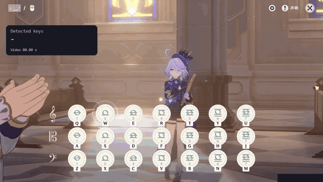
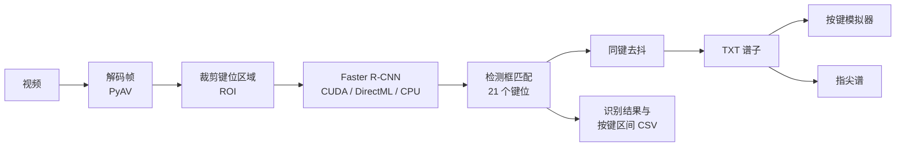

<div align="center">


# Key Press Detection

把原神风物之诗琴的演奏视频转成可以演奏的琴谱。


[English](README.md) | 简体中文

</div>

Key Press Detection 识别画面中的按键，生成带时间戳的 TXT 谱子。谱子可以用按键模拟器演奏，也可以转换为指尖谱。

## 演示

<div align="center">

[](docs/media/windsong-lyre-demo.mp4)

[带声音的视频](docs/media/windsong-lyre-demo.mp4) · [静态图片](docs/media/windsong-lyre-preview.png) · [识别生成的 TXT 谱子](docs/media/windsong-lyre_keys.txt)

</div>


## 功能

- 逐帧识别全部 21 个琴键，生成带时间戳的 TXT 谱子，原始识别结果另存为 CSV。
- 加载预览后可以移动键位框、点击禁用某些键，也能恢复默认位置。
- 在独立的模拟器窗口中把谱子演奏到游戏里，用快捷键暂停和停止。
- 把谱子转换为指尖谱，可设置 BPM、拍号、第一小节起点和每行小节数。
- NVIDIA 显卡可用 CUDA，NVIDIA、AMD、Intel 显卡均可用 DirectML，也可以回退到 CPU。
- 便携包自带 Python、依赖和模型，不需要另外安装。

## 工作原理



每一帧先裁剪到键位区域，再送入检测模型。检测框与 21 个键位区域匹配后，同一个键在去抖时间内的重复命中会合并，最后写入 TXT 谱子。

## 下载与运行

在 Releases 中选择 Windows x64 便携包：

| 版本 | GPU 推理 | 依赖 |
| --- | --- | --- |
| CUDA | NVIDIA 使用 CUDA；AMD、Intel 使用 DirectML | 包含 PyTorch 和 CUDA 运行库 |
| DirectML | NVIDIA、AMD、Intel 均使用 DirectML | 包含 ONNX Runtime，体积更小 |

> [!NOTE]
> 两个版本都支持 CPU 兜底。DirectML 默认 FP32，可在设置中切换混合精度；CUDA 使用独立的 AMP 开关。

1. 完整解压便携包，运行 `start.cmd`。
2. 选择视频和输出目录，加载预览。
3. 检查键位框，按需移动位置或点击禁用某些键，然后开始识别。

> [!TIP]
> 下载 CUDA 分卷包时，将 `.part001`、`.part002`、`.parts.json` 和 `join-release.cmd` 放在同一文件夹。双击 `join-release.cmd` 合并并校验 ZIP，完成后再解压。

### 系统要求

| 项目 | 要求 |
| --- | --- |
| 系统 | Windows 10/11 x64 |
| 显卡 | NVIDIA（CUDA 或 DirectML）、AMD 或 Intel（DirectML）；没有合适的显卡时使用 CPU |
| 驱动 | 对应显卡的驱动 |
| 其他软件 | 不需要。便携包已包含 Python、依赖和模型 |

## 模型下载

模型与便携包放在同一 Release 的附件中。更新或更换模型时，单独下载对应的模型包：

| 附件 | 用途 |
| --- | --- |
| `KeyPressDetection-Model-FasterRCNN-ONNX.zip` | DirectML 和 CPU，包含 FP32、混合 FP16 以及 batch 1、16 的模型文件 |
| `KeyPressDetection-Model-FasterRCNN-PyTorch.zip` | CUDA 版中的 CUDA 推理 |

将 ZIP 解压到程序目录，合并其中的 `models` 文件夹。在设置中选择 `models/faster_rcnn.onnx` 用于 DirectML，或选择 `models/faster_rcnn.pth` 用于 CUDA。

> [!IMPORTANT]
> ONNX 文件和 `weights.data` 必须放在一起。CUDA 版的 DirectML 和 CPU 兜底使用配套的 ONNX 模型，更新时要下载两个配套模型包。

## 输出文件

识别完成后，结果保存在输出目录，文件名沿用视频名称。每次任务生成一个独立文件夹：

| 文件 | 内容 |
| --- | --- |
| `<视频名>_keys.txt` | 去抖后带时间戳的谱子，供模拟器和谱子转换使用 |
| `<视频名>_detections.csv` | 已启用按键的逐帧原始识别结果及置信度 |
| `<视频名>_key_events.csv` | 每个键的按下区间（开始、结束、时长），由采样推断 |
| `<视频名>_summary.json` | 运行统计，如推理后端、精度、帧数和耗时 |
| `preview.jpg` | 最后一帧带按键高亮的预览图 |
| `task.log` | 简短的英文任务日志 |
| `job.json` | 任务元数据 |

停止任务会丢弃未完成的识别结果。谱子管理可以删除整次任务的文件夹。

### 谱子格式

每行依次是以秒为单位的时间戳、一个 Tab 和这一刻按下的键：

```text
0.90	Q,C
1.00	Q
1.33	Q,D
1.73	Q,A
```

键名对应游戏内的键盘布局：

<div align="center">

<kbd>Q</kbd> <kbd>W</kbd> <kbd>E</kbd> <kbd>R</kbd> <kbd>T</kbd> <kbd>Y</kbd> <kbd>U</kbd><br>
<kbd>A</kbd> <kbd>S</kbd> <kbd>D</kbd> <kbd>F</kbd> <kbd>G</kbd> <kbd>H</kbd> <kbd>J</kbd><br>
<kbd>Z</kbd> <kbd>X</kbd> <kbd>C</kbd> <kbd>V</kbd> <kbd>B</kbd> <kbd>N</kbd> <kbd>M</kbd>

</div>

空行和以 `#` 开头的注释会被忽略。模拟器支持 UTF-8、带 BOM 的 UTF-16 和 GB18030，文件最大 8 MiB、200,000 行，时长不超过 24 小时。

## 模拟器

模拟器可以读取已保存的 TXT，也可以上传谱子。它以管理员权限独立运行，关闭网页服务后仍可使用。

| 快捷键 | 作用 |
| --- | --- |
| <kbd>F6</kbd> | 开始、暂停或继续 |
| <kbd>F8</kbd> | 停止并复位 |

两个快捷键都能在设置中修改。切换窗口会暂停播放。

## 谱子转换

谱子转换支持指尖谱，可设置 BPM、拍号、第一小节起点和每行小节数。

| 写法 | 含义 |
| --- | --- |
| `G` | 单音 |
| `(DZ)` | 和弦，括号内的键同时按下 |
| `/` | 小节结束 |
| 空格 | 休止，同时用于排版 |

预览可以编辑，并下载为 `<原文件名>_formatted.txt`。模拟器只能演奏带时间戳的 TXT，不能直接读取指尖谱。

## 设置

按键去抖默认 50 ms。视频预览保持原比例，键位框支持恢复默认位置。CPU 线程数可在设置中调整。

## 常见问题

<details>
<summary>关掉浏览器后识别会停止吗？</summary>

不会。只要 CMD 窗口开着，识别就会继续。关闭 CMD 会结束网页服务和识别，未完成的结果也会丢失。打开 CMD 中显示的地址就能回到页面，通常是 `http://127.0.0.1:8765`；端口被占用时，程序会依次尝试后面的端口。

</details>

<details>
<summary>第一次运行为什么比较慢？</summary>

首次使用某个输入尺寸时，程序要准备模型并完成 GPU 编译。之后会使用本地缓存。

</details>

<details>
<summary>键位框和我的视频对不上。</summary>

键位框会随视频尺寸缩放，但画面布局不同时需要重新校准。用 **移动识别框** 拖动位置，或在高级参数中输入坐标；**恢复默认位置** 可以回到默认布局。保存布局后，下次任务可以直接使用。

</details>

<details>
<summary>谱子里漏了一些音。</summary>

降低分辨率或跳帧（帧间隔）都可能漏掉短音。可以使用默认输入尺寸、把帧间隔设为 1，或把置信度阈值从默认的 0.8 适当调低。更大的 batch 或更多 CPU 线程不一定更快。

</details>

<details>
<summary>同一个音被重复识别了怎么办？</summary>

可以在高级参数中适当增大 **同键去抖** 的时长，减少同一按键在短时间内的重复识别。时长过大也可能把真实的快速连按当作重复识别，导致漏音。

</details>

<details>
<summary>模拟器弹到一半停了。</summary>

切换窗口或按住修饰键会暂停播放并松开所有按键。回到游戏后按开始/暂停快捷键（默认 <kbd>F6</kbd>）继续。只切回窗口不会自动继续。

</details>

<details>
<summary>能不能在不发送按键的情况下测试模拟器？</summary>

可以。在程序目录运行：

```bat
runtime\python.exe simulator.py --dry-run
```

</details>

<details>
<summary>程序可以换个目录吗？</summary>

可以，复制整个程序文件夹即可。外部视频和自定义模型需要另外复制，路径变了要重新选择。模拟器播放时不要移动文件夹。

</details>

## 从源码运行

<details>
<summary>从源码安装并运行</summary>

安装 Python 3.12 x64，在项目目录运行其中一条命令：

```bat
install.cmd directml
install.cmd cuda
```

DirectML 下载 ONNX 模型包，CUDA 下载两个模型包。解压到项目目录后运行 `start.cmd`，依赖安装在 `.venv` 中。

两个便携版共用这份源码，通过打包参数区分。构建命令见[打包说明](docs/building.zh-CN.md)。

</details>

## 隐私

所有处理都在本机完成。网页服务只监听 `127.0.0.1`，并拒绝来自其他来源的请求。程序不使用第三方字体、JavaScript CDN、网页统计或外部推理服务。

## 免责声明

- 本项目是非官方的同人工具，与 HoYoverse / 米哈游无关，也没有得到其认可。《原神》是其所有者的商标。
- 模拟器会向游戏发送键盘输入。使用前请确认是否符合游戏的服务条款，风险自负。
- 识别他人的演奏视频时，请尊重原作者的权益。

## 第三方组件

Key Press Detection 使用了 [Python](https://www.python.org/)、[PyAV](https://github.com/PyAV-Org/PyAV) 与 FFmpeg、[NumPy](https://numpy.org/)、[Pillow](https://python-pillow.org/)、[ONNX](https://onnx.ai/) 和 [ONNX Runtime](https://onnxruntime.ai/)（DirectML）。CUDA 版还包含 [PyTorch](https://pytorch.org/) 和 Torchvision。许可证详情见 [THIRD_PARTY_NOTICES.txt](THIRD_PARTY_NOTICES.txt)。

## 文档

- [使用说明](USER_GUIDE.md)：参数、设备、模拟器和输出格式的详细说明
- [打包说明](docs/building.zh-CN.md)：源码包、便携版和模型附件的打包方法
